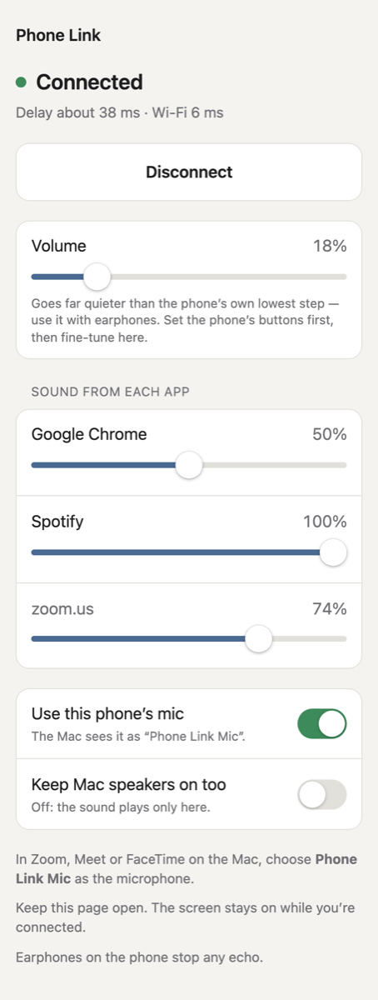

# Phone Link — use your iPhone as wireless headphones and a microphone for your Mac

Phone Link plays your Mac's sound on your iPhone, and turns the iPhone's microphone into a Mac
microphone called **Phone Link Mic** that Zoom, Google Meet, FaceTime, Discord or any other app can
pick. It all runs over your home Wi-Fi through a web page in the phone's browser.

- **No iPhone app to install.** The phone side is a web page; nothing to sideload or re-sign every 7 days.
- **No audio driver on the Mac.** It uses the Core Audio process taps built into macOS, so there is
  no kernel extension, no BlackHole/Loopback, and nothing to remove from your audio setup afterwards.
- **Low delay.** About 20–25 ms of buffering on the phone, adjusting itself to your Wi-Fi.
- **Volume that goes lower than the phone allows.** With earphones, even the iPhone's lowest
  volume step can be loud. Phone Link's own slider goes all the way down to silence.
- **A volume slider for each app.** Turn a loud browser tab down without touching your music or
  your call.

<p align="center"></p>

---

## Contents
- [What you need](#what-you-need)
- [Install](#install)
- [First-time setup](#first-time-setup)
- [Everyday use](#everyday-use)
- [Volume controls](#volume-controls)
- [Using the phone as a microphone](#using-the-phone-as-a-microphone)
- [Tips](#tips)
- [Troubleshooting](#troubleshooting)
- [Security and privacy](#security-and-privacy)
- [Uninstall](#uninstall)
- [How it works](#how-it-works)
- [Building and project layout](#building-and-project-layout)
- [Known limitations](#known-limitations)

---

## What you need
| | |
|---|---|
| **Mac** | macOS 15 Sequoia or later (developed on macOS 26 Tahoe). Apple silicon or Intel. |
| **Phone** | An iPhone with Safari. Chrome and Firefox on iPhone also work for daily use. |
| **Network** | The Mac and the phone on the same Wi-Fi network. No internet connection is needed. |
| **To build it** | Apple's free Command Line Tools (gives you `swiftc`). Full Xcode is not needed. |

## Install
1. **Get the Command Line Tools** (skip if you already have them). In Terminal:
   ```sh
   xcode-select --install
   ```
2. **Download and build Phone Link:**
   ```sh
   git clone https://github.com/potJim80/PhoneLink.git
   cd PhoneLink
   ./build.sh --install
   ```
   This builds `Phone Link.app` and copies it into your Applications folder (or `~/Applications`
   if you can't write to `/Applications`). Running `./build.sh` without `--install` builds it in the
   project folder only.
3. **Open Phone Link** from Applications. It has no window: look for a small phone icon in the
   menu bar at the top of the screen.

## First-time setup
You do this once per Mac and once per phone.

### On the Mac
When Phone Link opens for the first time, macOS asks two things:
- **Permission to record the computer's audio** → click **Allow**. This is how it hears
  the Mac's sound. If you missed it: System Settings › Privacy & Security › Screen & System Audio
  Recording › turn on Phone Link (under "System Audio Recording Only"), then quit and reopen Phone Link.
- **Permission to accept incoming network connections** (only if the macOS firewall is on) → click **Allow**, so
  the phone can reach the Mac.

### On the iPhone
Safari only lets a web page use the microphone over a secure (https) connection, so the phone has to
trust your Mac once. Phone Link makes its own small certificate for this; nothing is sent anywhere.

1. Click the Phone Link icon in the Mac's menu bar. It shows two QR codes.
2. With the iPhone's **Camera**, scan the one labelled **"First time? Setup"**. It opens the setup page
   in Safari. (Or type `http://<your Mac's name>.local:8580` into Safari. You can find the name under
   System Settings › General › Sharing › Local hostname.)
3. Follow the three steps on that page:
   1. Tap **Get certificate**, then **Allow** to download it.
   2. **Install it:** Settings › General › VPN & Device Management › Phone Link › **Install**.
   3. **Trust it:** Settings › General › About › Certificate Trust Settings › turn on **Phone Link**.
4. Go back to the setup page in Safari. It should say **"This phone trusts the Mac. You're set."**
   Tap **Open Phone Link**.

Do the certificate steps in **Safari**. After that, Chrome and Firefox on the iPhone work too.

## Everyday use
1. Make sure Phone Link is running on the Mac (phone icon in the menu bar).
2. On the iPhone, open the Phone Link page: scan the **"Phone page"** QR code in the menu, or use
   the Home Screen icon (see [Tips](#tips)).
3. Tap **Connect**. The Mac's sound now plays on the phone.
4. Tap **Disconnect** when you're done. The Mac's speakers come back on by themselves.

While a phone is connected, the Mac's own speakers are muted so the sound plays only on the phone. To
hear it in both places, turn on **Keep Mac speakers on too**, on the page or in the menu bar menu.

The menu bar icon changes when a phone is connected, and the menu shows whether the phone's mic is on.

## Volume controls
### Volume (the whole phone)
The **Volume** slider turns down everything you hear on the phone, far below the iPhone's lowest
volume step. It's made for earphones, where even one step on the phone's buttons can be too loud.

- Set the phone's volume buttons to a low step first, then use the slider to fine-tune.
- The slider follows how loud things sound to your ear rather than a straight line: 50 % is about a
  quarter as loud, 10 % is very quiet, and 0 % is silent. Most of the slider covers the quiet end.
- The phone remembers your setting for next time.
- It adds no delay.

### Sound from each app
Under **Sound from each app** there is one slider for each Mac app that has played sound since you
connected: a browser, Spotify, Music, Zoom, and so on.

- Drag an app's slider to change how loud that app is on the phone. Other apps aren't affected.
- An app that has stopped playing for now is shown greyed out. Its slider still works.
- The Mac remembers each app's level, so your browser stays quiet the next time you connect.
- The very first time you move an app off 100 %, there may be a tiny blip while Phone Link starts
  listening to that app on its own. After that, changes are instant and smooth.
- These sliders change only what goes to the phone. If **Keep Mac speakers on too** is on, the Mac's
  speakers still play every app at its normal level.

How apps are named: helper processes are counted as their app, so Chrome's "Google Chrome Helper"
appears as **Google Chrome**. Safari, Mail and other apps built on Apple's WebKit play web sound
through one shared system process, so they share one slider called **Safari & web pages**.

## Using the phone as a microphone
1. On the page, leave **Use this phone's mic** on (it is on by default). The first time, Safari asks
   to use the microphone: tap **Allow**.
2. In your call app on the Mac, choose **Phone Link Mic** as the microphone:
   - **Zoom:** Settings › Audio › Microphone
   - **Google Meet:** the ⋮ menu › Settings › Audio › Microphone
   - **FaceTime:** the Video menu (menu bar) › Microphone
   - **Anything else:** System Settings › Sound › Input
3. Talk. The phone's own echo cancelling and noise suppression are on.

**Phone Link Mic** exists only while Phone Link is running. When the phone isn't sending, it's silent.

## Tips
- **Make it an app icon.** With the Phone Link page open in Safari, tap Share › **Add to Home Screen**.
  It then opens full-screen like an app.
- **Keep the page open.** The phone keeps its screen on while connected (most reliable in Safari).
  If the phone locks or you switch apps, iOS may pause the sound; come back and tap **Resume**.
- **Use earphones** if the phone's mic is on. That avoids any echo from the phone's speaker.
- **Delay** is shown under the status (for example "Delay about 38 ms · Wi-Fi 6 ms"). If your Wi-Fi
  drops out, Phone Link buffers a little more for a while, then slowly goes back to the lowest delay
  that works.
- **One phone at a time.** If a second phone connects, the first one is disconnected.

## Troubleshooting
| Problem | What to try |
|---|---|
| Phone page won't load | Check the phone and the Mac are on the same Wi-Fi (not a guest network) and that Phone Link is running. Some public or school networks block devices from seeing each other; use a home network or a personal hotspot. |
| Safari says the connection is not private | The certificate isn't trusted yet. Redo step 3 of [the phone setup](#on-the-iphone), especially the **Certificate Trust Settings** switch. |
| Connected, but no sound | Check System Settings › Privacy & Security › Screen & System Audio Recording › Phone Link is on, then quit and reopen Phone Link. Also check that the phone's silent switch and volume aren't all the way down, and that the page's Volume slider isn't at 0 %. |
| "The phone didn't allow the mic" | Settings › Apps › Safari (or your browser) › Microphone › Allow. |
| Phone Link Mic isn't in my call app's list | Phone Link has to be running. Restart the call app after opening Phone Link. |
| The Mac's speakers stay silent | They are muted only while a phone is connected. Disconnect on the phone, or turn on **Keep Mac speakers on too**. Quitting Phone Link always brings them back. |
| An app is missing from "Sound from each app" | It only appears once it has played sound since you connected. Play something in it. |
| Menu bar says "Phone Link isn't working" | Usually another program is using port 8580 or 8581. Quit it and reopen Phone Link. |
| Changed Wi-Fi networks or renamed the Mac | Nothing to do on the phone. Phone Link makes a new server certificate by itself; the phone keeps trusting it. |

## Security and privacy
- **Everything stays on your network.** No accounts, no cloud, no tracking. Sound goes directly
  between the Mac and the phone.
- **There is no password.** Anyone on the same Wi-Fi who opens the page can connect and hear the
  Mac's sound. Use Phone Link on networks you trust, and quit it when you're not using it.
- **The certificate.** Phone Link creates its own certificate authority on your Mac, stored in
  `~/Library/Application Support/PhoneLink`. Your phone trusts it so the page can use https.
  Anyone who copied that folder's private key could create certificates your phone would trust,
  so keep your Mac account private. If you stop using Phone Link, remove the profile from the phone
  (see [Uninstall](#uninstall)).

## Uninstall
1. Quit Phone Link (menu bar icon › **Quit Phone Link**) and delete it from Applications.
2. Remove its certificates and saved settings. In Terminal:
   ```sh
   rm -rf ~/Library/Application\ Support/PhoneLink
   defaults delete local.mahdi.phonelink
   ```
3. On the iPhone: Settings › General › VPN & Device Management › Phone Link › **Remove Profile**.
   Delete the Home Screen icon if you made one.

---

## How it works
**Mac → phone.** A Core Audio *process tap* captures everything the Mac plays (except Phone Link
itself) through a private aggregate device. That gives 32-bit float audio, which goes out as 16-bit
stereo PCM over a WebSocket in packets of about 10 ms. The tap can mute the Mac's speakers while it
listens. On the phone, an AudioWorklet plays from a small jitter buffer that grows after a dropout
and shrinks again when the Wi-Fi is steady, with gentle drift correction instead of audible jumps.

**Per-app volume.** Core Audio lists processes, not apps, so each process is filed under the outermost
`.app` bundle it runs from. Apps set to anything other than 100 % get their own process tap, and all
the taps sit in the same aggregate device, which keeps them in sync. The Mac mixes them with each
app's gain, ramped over one audio block so there are no clicks. Everything else shares one global
tap. Changing a level is just a number the audio thread reads. The capture is rebuilt only when an
app first gets its own tap or its processes change.

**Phone volume.** The page multiplies the sound in its audio thread, on a cube curve
(gain = (slider ÷ 100)³), so it can go much quieter than the phone's hardware steps without adding
any delay.

**Phone → Mac (the microphone).** The page sends 10 ms chunks of the phone's mic back over the same
WebSocket. Phone Link plays them out of its own process, taps its own process (muted, so you never
hear it), and publishes that tap as a *public* aggregate device. That device is **Phone Link Mic**.
This is how it works with no virtual audio driver.

**HTTPS.** The app is its own small certificate authority, made with macOS's built-in
`/usr/bin/openssl`. The server certificate covers the Mac's `.local` name and current IP addresses
and is remade when those change. The phone only has to trust the authority once.

**Ports.** 8580: plain http, setup page and certificate download. 8581: https, the Phone Link page and
its WebSocket (`/ws`).

## Building and project layout
```sh
./build.sh            # builds "Phone Link.app" in this folder
./build.sh --install  # also copies it to /Applications (or ~/Applications)
```
After rebuilding, quit and reopen Phone Link; the page files are loaded when it starts.

| Path | What it is |
|---|---|
| `src/main.swift` | Menu bar app (QR codes, menu) and the glue between audio and network |
| `src/Audio.swift` | System-sound capture taps, per-app mixer, the Phone Link Mic device, mic jitter buffer |
| `src/Apps.swift` | Works out which apps are playing, for the per-app sliders |
| `src/Server.swift` | Small HTTP + WebSocket server on Network.framework |
| `src/Certs.swift` | The certificate authority and server certificate |
| `src/page/index.html` | The phone page |
| `src/page/worklet.js` | The phone's audio thread: playback buffer, volume, mic chunks |
| `src/page/setup.html` | The first-time setup page |
| `src/make-icon.js` | Draws the app icon at build time |

Environment switches for development: `PHONELINK_HEADLESS=1` runs without the menu bar, and
`PHONELINK_NO_MUTE=1` never mutes the Mac's speakers.

No third-party code or package manager: only Swift, Apple's frameworks, and plain HTML/JavaScript.

## Known limitations
- Made and tested for **iPhone**. Android phones may work but haven't been tried, and installing
  the certificate works differently there.
- **One phone at a time.**
- iOS may **pause the page** when the phone locks or you switch apps. Come back to it and tap Resume.
- With the mic on and no earphones, iOS decides whether sound comes from the bottom speaker or the
  earpiece. Earphones avoid both that and echo.
- Per-app volume affects only the sound sent to the phone, not the Mac's own speakers.
- The delay depends on your Wi-Fi. A busy 2.4 GHz network adds more than 5 GHz.

## License
MIT. See [LICENSE](LICENSE).
